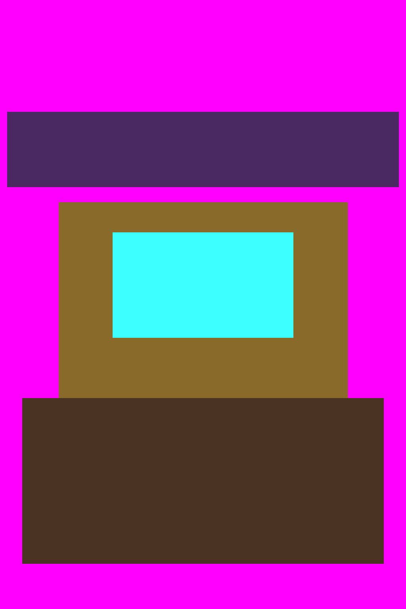
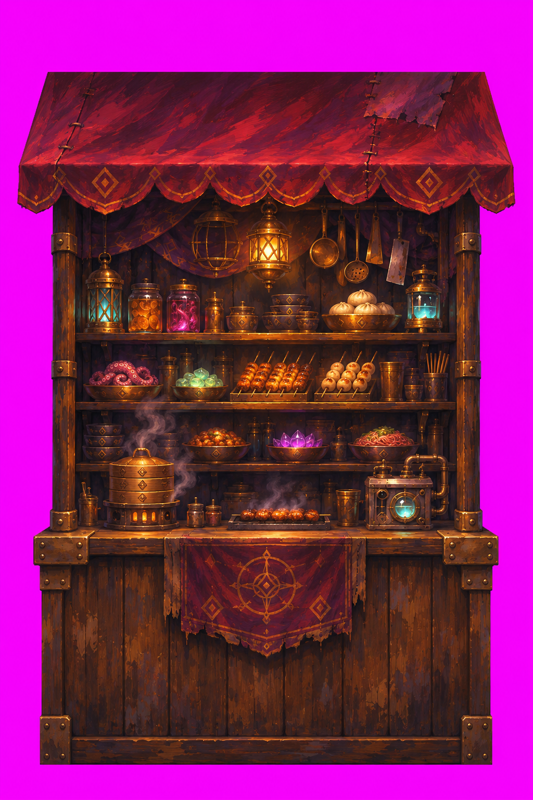
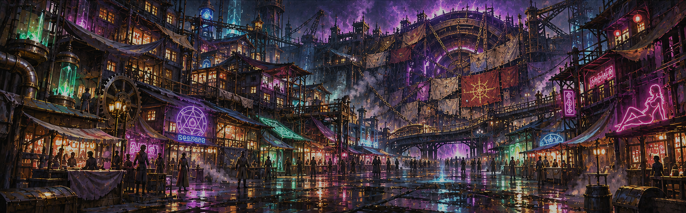

# SA2 T4 / stall_game — 原本画像付き制作発注書（2026-11-09）

**用途:** 画像生成チャットへこの文書の画像3点を引用・添付し、**遊技屋台1点だけ**を塗る。完成品や品質検証済みを宣言する文書ではない。

**正本:** [引き継ぎとT4停止条件](../../docs/sa2_t3_design_gate_20261108/reports/sa2_handoff_20261109_t3_review_t4_art_failure.md) / [不足素材・制作契約](../../docs/sa2_t3_design_gate_20261108/reports/t4-market-art-gap-and-production.md) / [guide.json](guide.json) の `v2.parts.stall_game` と `v2_w_bar_shack_low.stalls` / [裏町v2](../../specs/backtown_entrance_v2.md)。

## 1. 編集対象：GitHubに登録済みの**原本**（これが第一画像）

[原本PNGを開く](stall_game.png) ／ Git blob SHA: `7e21a0b403bef54123d4762f6c4eb8a7e75d2466`。**過去の不採用生成結果や他の参考画像に置き換えない。**

## 2. 既存の合格済み画風見本（第二画像）

[画風見本の原寸PNG](../painted_bt_src/stall_food.png)

- 参考にするのは塗りの筆致・材質・光量・夜の暗さ・描き込み密度だけ。食べ物、屋根形状、屋台パーツを `stall_game` に移植しない。
- 補助比較用: [既存採用の部品屋台](../painted_bt_src/stall_parts.png)（第三の製作対象ではない）。

## 3. 世界観・空気の見本（第三画像）

[世界観見本の原寸PNG](../concept/concept_low_dark_a.png)

世界観は退廃した帝都裏町の夜の歓楽街。密集した魔導技術、古い真鍮と銅、鉄、深い紫の陰影、控えめなシアン・桃・緑の光と暖色の反射。**背景や周辺の街並みを描き足さない。** 紙の提灯と判読可能な文字をコピーしない。

## 4. 今回の塗り直し指示（単体1枚のみ）

**成果物:** `stall_game` という1つの正面向き遊技屋台。構図を変えず、第一画像のフラットな色面を詳細なデジタル油彩の表面に塗り直す。見える厚み・材質は光と陰影によって表す。**画像を使った仕様書・ポスター・Before/After・モック・全景・複数コマを出さない。**

**固定する形状・領域:**
- 紫 `#4a2a62`：上端の長い横長矩形＝屋台の布屋根・庇
- 真鍮 `#8a6a2c`：その下の四角い筐体＝歯車仕掛けの遊技機械
- シアン `#30e0ff`：筐体中央の一つの横長矩形＝機械の画面、ディスプレイ面。**別の画面や追加の機械を作らない**
- 茶色 `#4a3424`：下端の幅広い矩形＝木製の手前カウンター
- マゼンタ `#ff00ff`：すべて素材外。均一な単色のまま残す。完成後に元ガイドのマスクで透明化する。

**形状禁止事項:** 既存輪郭・境界・外接座標・上下左右の位置・各矩形の幅と高さを変えない。側面パース・斜め視点・奥に伸びる店内・突出する柱・周囲の建物・路面・床・人物・看板・文字・UI・余白外へのはみ出しは不可。模様、サビ、リベット、微細な歯車感は**ガイドの各領域の内部だけ**に留める。消灯で描くべき設備を過剰に発光させない。

**画風:** 密度の高い手描きデジタル油彩。見える厚い筆跡と局所的な強い明暗。古びた真鍮・銅・鉄、擦れた布、木目、湿った空気。フォトリアルなCG、清潔な現代バー、セル塗り、古典絵画にはしない。暗い紫基調で、機械面の水色だけを強い視線誘導点にする。文字と人物は描かない。

**制作元キャンバス:** 1024 × 1536 px。原本の正面投影を固定。Godot 側の区画: `STALLS x=4.3m, w=2.4m, h=3.0m`。ガイド画像の世界範囲: `x0=2.95263157894737, x1=5.64736842105263, y0=-0.3, y1=3.7421052631579`、`380 px/m`。これは**ガイドのソースキャンバス**であり、後工程の切り抜き後寸法とは区別する。

## 5. 受入と停止条件（画像を生成しただけでは完成ではない）

1. 出力は単体画像1点であり、正面投影・屋根/筐体/画面/カウンターの形状が第一画像に一致していること。全景絵・説明ボード・他の店・人物・床・文字が入れば不採用。
2. Python/Pillowなどの決定的処理で原本の各色面マスクを取得し、**マスク外側を必ず透明にする**。自動マゼンタ除去の結果に背景オブジェクトが残っていないか検査する。生成AIによる1px完全一致は保証できないため、マスクは**元原本から**取る。
3. 1024×1536 のソース、最終RGBA、背景alpha=0、各領域の外接矩形・輪郭、halo、不要背景残留を数値と実画像で検証する。元ガイドと合わない場合は不採用。原本を基準にした領域別合成以外で形状を捏造しない。
4. 現行 `sequel/tools/cut_bt.py` は既存の3種屋台だけを対象にしており、**新規 stall_game の処理はまだ実装されていない**。スクリプトの実処理を読んで、T4隔離ブランチで必要な最小追加を検証する。
5. Godot 4.7.2 の**実レンダリング**でカメラ、既存床・他の屋台・住民・キャラとの縮尺・遮蔽を確認する。画像生成モックは代用にならない。実行できなければ NOT TESTED。
6. 最初の `stall_game` 1枚を受入するまで、残り4壁を制作しない。**main、SA1、T2、T3ブランチ/コードは変更しない**。
7. 完成報告には原本SHA、実際の生成ソース、透明PNG、マスク・寸法/形状のQA、Godot実画面を添え、PASS / FAIL / NOT TESTEDを明示する。前の不採用画像を流用しない。

## 6. 画像生成チャットへの短い依頼文

> このGitHub発注書に表示された**第一画像 stall_game.png を画像編集の原本**としてください。第二画像は既採用の画風見本、第三画像は世界観見本です。本文4節の形状固定・禁止事項を守り、第一画像の矩形・位置・輪郭を変更せず、**遊技屋台の単体の塗装画像を1枚だけ**生成してください。説明図、仕様書ポスター、街の背景は出力しないでください。生成後の透過・ピクセル形状一致は別途決定的QAで確認します。

**注意:** GitHub Markdownに画像を埋め込んでも、別の画像生成モデルがそのURLの画像を自動的に読み取る保証はありません。生成時はこのページの**第一画像を画像添付**し、第二・第三を参照画像として添付すること。アクセス・添付ができない場合、画像を読んだふりをして生成しない。
