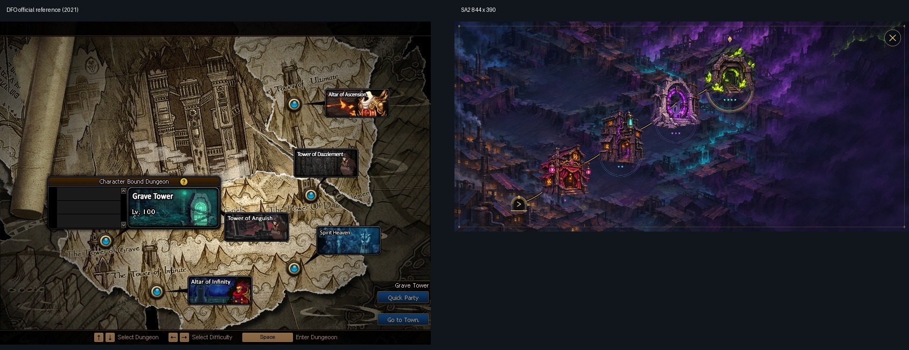
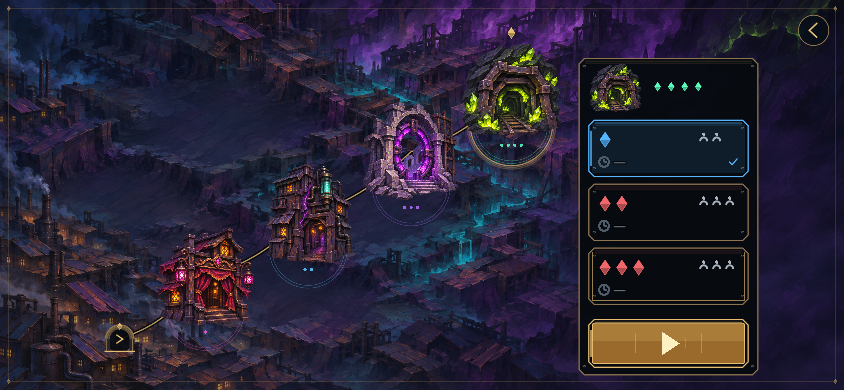
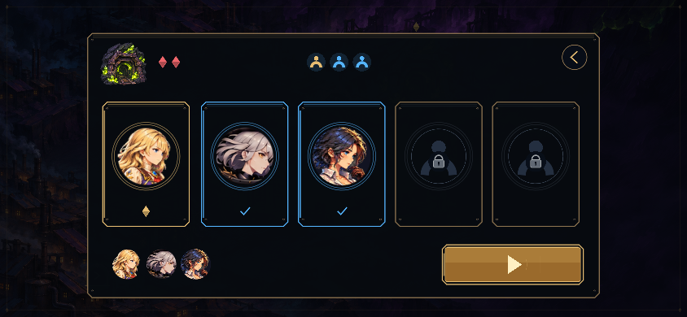
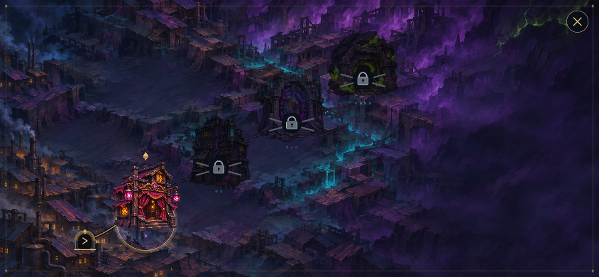
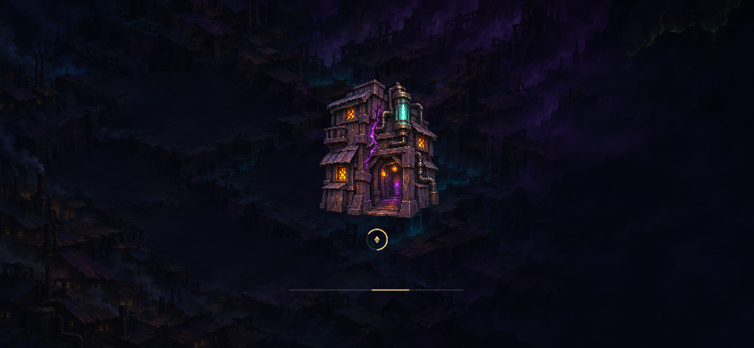
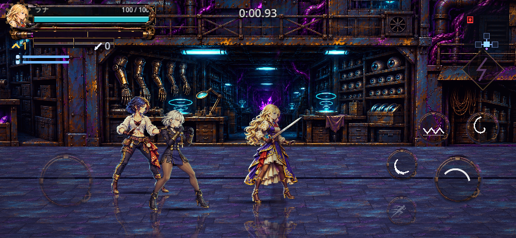
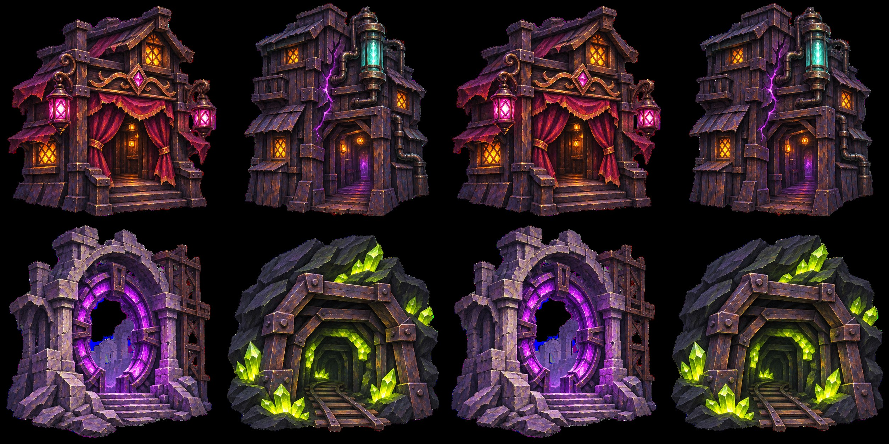

# ダンジョン選択画面 制作結果（2026-11-15）

ソース: `codex/dungeon-select-ui-20261115`、実装 `108702a`。土台 `a62f698`（claude/skill-tree-implementation-fsvlcl）。Godot 4.7.2、Web ビルド `20261114161846-108702a-g4.7.2`。

試す URL: https://yyvape-dev.github.io/SA/previews/sa2-dungeon/?town=back&at=gate&unlock=1

## 実装した物（事実）

- A: 夜の帝都の地下〜裏町。地は厚塗り、道・開閉はコード。門とT1〜T4だけ、将来の仲間は2枠（ユーザー確認済み）。
- B: 歓楽街・半魔界の路地・廃墟・採掘坑の入口4枚。未開放は暗色・鎖・錠。
- C/D: 門と金の選択環。C〜Gの枠・記号・動きはコード描画。
- E: 青／赤／赤＋金の難易度札、人数、時計、最速の数字、金の入場ボタン。
- F: 既存の採用済み顔絵。ラナ固定、リリィ・ランカ、将来2枠。未読込・人数超過・固定を区別。
- G: 短い開閉・札の移動・押下の光。入力の同じイベントで反応、入力ガード50ms。実機で100ms未満かは未測定。
- H: 選択した入口と同じ背景、回転印、実際の通信進捗。サイズ不明なら不定進捗、再試行はリセット。待っている間は背後の街を描画しない。

参照は本番の w_shady / back_alley_1 / T4 room。生成は使用する背景1枚と4入口のアトラスのみ。元PNGは art/ui_source/dungeon_select/（.gdignore）、生成情報は provenance.json。

背景1860×845、各入口627×627。縮小・再サンプリングなし。WebP lossless + exactで透明部分のRGBも保存。元と復元画像を同寸比較し差分0。背景約1.8MB、UI絵合計約3.6MB。本体pckにUI資源を収録し、地区pckに重複しない。

## 844×390 とお手本の比較

お手本: [DFO公式 Dungeon update](https://www.dfoneople.com/news/updates/2460/Dungeon)、[原画像](https://static.dfoneople.com/publish/bbs_data_st1_neople/images/pds/dff3fd61cb/2_GraveTower.jpg)。比較資料の引用でありゲームには収録しない。

| 観点 | DFO公式の例 | 今回のSA2 |
|---|---|---|
| 地図 | 羊皮紙、地点が多数 | 夜の厚塗り、門＋4入口 |
| 行き先 | 場所の絵と名称 | 入口絵・道・テーマ色・選択環 |
| 詳細 | 地図に重なる詳細窓 | 入口を覆わない右の札 |
| 難易度 | 名称・操作説明 | 青／赤／赤金と菱形1〜3 |
| 操作 | キー案内中心 | 844×390で44px以上のタップ領域 |
| 仲間 | この参考画像には表示なし | 顔絵・固定の金・選択の青・錠 |

5問への回答（画面からの解釈。実ユーザー評価ではない）:

1. 何の画面か: 門から行けるダンジョンを選ぶ地図。
2. 何をすればいいか: 開いた入口→難易度→金の決定→仲間→金の入場。
3. 押すと何が起きたか: 入口に金環、難易度札が出て、選んだ仲間が青になる。
4. なぜか: 開放状態・難易度・人数上限に応じて金／青／錠が切り替わる。
5. 次は何か: 選んだ仲間で入場し、入口絵の待機画面を経てダンジョンへ。

## 確かめたこと（事実）

- レイアウトテスト: 844×390 / 1280×720、全操作44px以上、画面内、入口と右札の重なりなし。揺れ中も描画・判定が同じ矩形。
- 状態テスト: 鍵、人数上限、未読込／将来の仲間、戻る、実進捗、再試行リセット、街描画の復元。
- open_menu / choose_theme / choose / toggle_ally / go / menu_back / party_cap の本体は土台と同一。main.gd は変更なし。
- CAPTURE_MENU: TOWN=back、UNLOCK_ALLあり／なし、各menu_0〜5を844×390で撮影。
- DUNGEON_TEST: 当初300秒制限では時間切れ。描画なし・900秒制限の監視ラッパーで元のbotを完走し DUNGEON DONE。鍵3つが「正しい」、run1〜4クリア、run5失敗復元、run6帰還復元。最初の周回384.87ゲーム秒、全14部屋。
- export_web.py: 地区の不足資源なし、どのpckにも無い絵なし。本体58.3MB、dg1 59.4MB、dg_t2 10.1MB。
- serve_gzip.py + Chromium 844×390: 門→T2→ハード→ランカ選択→入場、dg1/dg_t2 load_resource_pack成功、pageerrorなし。実リクエストを18秒保留して待機画面を撮影。通信を模した進捗値は使っていない。
- レビュー指摘2件（揺れとタップ判定／再試行の古い進捗）を回帰テストとともに修正。

## 未確認・仮説

- iPhone実機の見え方・入力遅延・メモリは未確認。Chromiumの結果から実機性能は断定しない。
- 未選択の仲間がいるネイティブ撮影の終了時に、GPU/Nodeの解放警告を観測。操作中のSCRIPT ERRORはなし。既存benchの未接続ノードが原因というのは仮説で、指定どおりmain.gdのパーティは変更していない。
- 説明文字なしで初見の人に意味が伝わるかは未評価。上の5回答は制作者の確認でありユーザーテストではない。
- 今回のデザインに関する未決質問はなし。ゲーム全体の敵数値等は従来のHANDOFFのまま。

公開は main の previews/sa2-dungeon/ だけ。ソースは作業ブランチに置き、main の sequel/web/ は変更しない。
