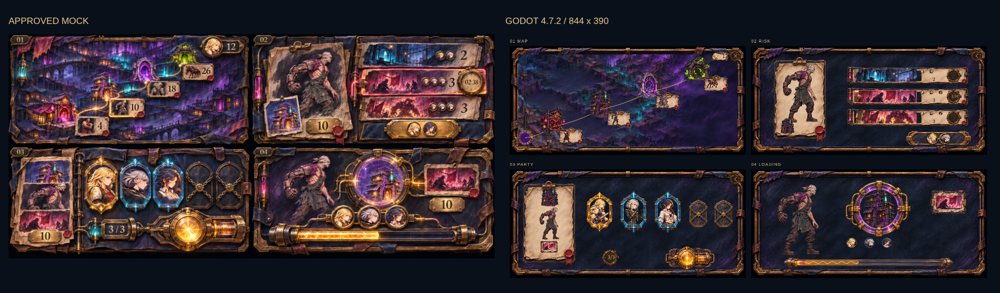
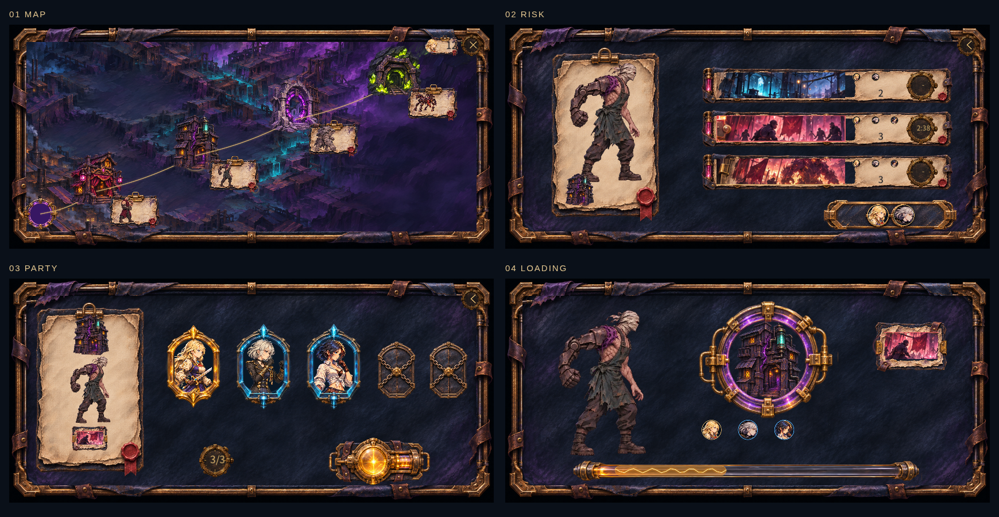

# 魔導式遠征盤の実装結果（2026-11-15）

採用案: [画像生成モック](dungeon_select_mock_v2/mock_board_world_design.png)。ユーザーの「これでいこう。作業を」に基づく実装。ソースはcodex/dungeon-select-ui-20261115、実装7c22d21（Godot4.7.2）。mainには試し版previews/sa2-dungeon/のみ。

URL: https://yyvape-dev.github.io/SA/previews/sa2-dungeon/?town=back&at=gate&unlock=1

## 変わった物（事実）

- 地図: 敵の調査札を追加。建物と札のどちらを押しても同じダンジョンへ。選択・進行の鍵・クリアを絵へ反映。
- 難易度: 全画面の盤面。敵の原画を大きく載せ、青の路地／赤い待ち伏せ／赤金の激戦の現場絵3枚で比較。人数は小さな肖像と数字、最速は時計の数字。次へは肖像をはめた金属の札。
- 編成: 行き先・敵・難易度を左に残し、ラナ金固定、仲間青、将来2枠は鎖で閉じた台座。出発は金の魔導装置。菱形の難易度列・ドアの線画・人型の列・チェック列は撤去。
- 待機: 同じ敵・行き先・編成を残す。レンズとガラス管の光は実際の地区ダウンロード進捗に連動。サイズ不明なら不定進捗、再試行はリセット。街の移動では前のダンジョンを出さない。
- 地図／待機中は3Dと裏側の戦闘操作HUDを描画しない。閉じる・読み込み終了・HUD退出時には、元の表示と入力設定へ復元。

## モックとの比較

この4画面は描画確認用fixture（レベル12、T2ハード、記録2:38、仲間2人選択）。実データで門から入った撮影・Web検証も別に実施。待機のfixtureは42%の見本で、実検証の通信進捗とは区別する。

| 項目 | 採用モック | Godotの実装 |
|---|---|---|
| 材質 | 革・布・真鍮・魔導管 | 同じ意匠で生成した独立部品を合成 |
| 調査札 | 敵＋推奨値 | 実際の敵原画＋推奨値の表示処理。数値はユーザー回答待ち |
| 敵・仲間 | 生成で細部が変わる | 採用済み原画の切り出し、縦横比維持 |
| 危険度 | 現場絵3枚、青／赤／赤金 | 現場絵を札へ載せ、開放・選択・記録を実値で更新 |
| 肖像の台座 | 金固定・青選択・鎖2枠 | 既存の仲間可否・人数上限と接続 |
| 起動装置・管 | 一枚絵の光 | 出発操作・実通信・時間の動きとして分離 |
| 細部 | 機械の装飾が多い | 844×390で触れるよう紙・時計・枠の比率を調整 |

5問:

1. 何の画面か: 帝都の裏町から潜る行き先と遠征隊を決める盤面。
2. 何をすればいいか: 入口／敵の札→現場絵で難易度→肖像札で仲間→金の起動装置。
3. 押すと何が起きたか: 調査札が開き、選んだ危険度が点灯し、選んだ仲間の台座が青くなる。
4. なぜか: 行き先・進行の開放・仲間の読み込み・人数に応じた状態を表示している。
5. 次は何か: 金の装置で出発し、同じ行き先のレンズと光る管を経て戦闘へ。

これは制作者の解釈で、初見ユーザーの評価結果ではない。

## 素材と検証（事実）

- 生成した背景・部品シート3枚と採用モック・既存原画から部品化し、実行用は計23点・約6.1MB。背景の地図は従来の約1.8MBを使用。本体pck約64.4MB。
- 敵・上半身は元のスプライト／立ち絵から原寸で切り出し。すべてlossless WebP exact、23点のRGB/RGBA画素差分0、再サンプリングなし。同寸の並列比較はart/ui_source/expedition/*native_compare.png。
- 絵の縦横比を保持。布・紙・ガラスの無地の面と縁だけをUIの九分割で調整。原画はart/ui_source/expedition/に保存し.gdignoreで本体から除外。
- 本体PCKの実目録で実行用23点、art/ui_source/が0件。敵の巨大な原アトラスは従来どおり地区側。
- 844×390 / 1280×720、遷移開始／途中／完了、全操作44px以上、隠れた地図の判定なし、揺れとタップ矩形の一致をテスト。
- 状態テスト: 調査札の実タッチ、同イベントでの反応開始、鍵、人数上限、未読込／将来の仲間、戻る、読み込みスナップショットの独立、再試行、街の文脈、表示と入力の復元。
- open_menu / choose_theme / choose / toggle_ally / go / menu_back / party_capは土台a62f698と本体同一。main.gd変更なし。
- 元のDUNGEON_TESTを完走: 鍵3件「正しい」、run1〜4クリア、run5失敗復元、run6帰還復元、DUNGEON DONE。
- CAPTURE_MENU、TOWN=back、開放あり／なしのmenu0〜5を撮影。未選択仲間がある撮影の終了時の解放警告は前回から継続、操作中のSCRIPT ERRORとは区別。
- Webはgzipサーバー＋Chromium844×390でT2→ハード→編成→入場、dg1/dg_t2読み込み成功、pageerror0を確認。dg1実リクエストを18秒保留し、実際の待機画面を撮影。

## 描画間隔の測定（事実）

Chromium＋SwiftShader（ソフトウェアWebGL）の地図でrequestAnimationFrame間隔を測定。初回は中央値約300ms、3D停止後約200ms、隠れた戦闘HUDの停止と道の描画集約後約100ms、街の画面読み取り効果も止めた最終版は中央値50ms（正の19サンプル、範囲16.7〜116.7ms）。これは同じ環境での観測値で、実タッチから発光までの遅延やiPhoneの計測値ではない。すべてのフレーム100ms未満は確認できていない。

## 未決・未確認

- 推奨レベル4/10/18/26はモックで明示した仮値。表示してよいかの回答待ちのため、RECOMMENDEDは未設定（0、非表示）。プレイヤーの現在レベルは実値。推奨値は入場条件に使わない。
- iPhone実機の入力遅延・描画・メモリは未検証。入力処理が100ms未満でも、画面に出るまで100ms未満と同じ意味ではない。
- ネイティブ終了時の解放警告の原因が既存benchという点は仮説で、main.gdのパーティには手を加えていない。
- 機械の装飾と文字なしの説明が初見で理解できるかは要ユーザー評価。

検証ログ: [自動周回](expedition_apparatus_validation/dungeon-test.log)、[最終Web](expedition_apparatus_validation/web-release.log)、[書き出し](expedition_apparatus_validation/export-release.log)、[状態](expedition_apparatus_validation/state-green.log)。実通信中の[待機](expedition_apparatus_img/web_loading.png)と[入場後](expedition_apparatus_img/web_dungeon.png)。

## 公開確認（事実）

- main `749438e151b3debd5f6e6db34488a7dfee44ab89`。公開直前main `646aecc` との差分はpreviews/sa2-dungeon/の10ファイルのみ。既存の追加パック等は残し、本編sequel/web/は変更しない。
- [Pages配信成功](https://github.com/yyvape-dev/SA/actions/runs/43667918757)。公開URLをChromium844×390で起動、HTTP200、index.pck?v=20261115021721-7c22d21-g4.7.2を読み込み、地図→T2難易度へタップ、pageerror0。
- 公開版の[地図](expedition_apparatus_img/public_map.png)／[難易度](expedition_apparatus_img/public_diff.png)。推奨値は回答待ちのため空欄。公開ログもvalidationに保存。

検討用HTMLの過人数表示とは異なり、本体は指定されたchoose()を保ち、難易度を決め直すと前回編成を新しい上限内で復元する従来動作を維持している。
