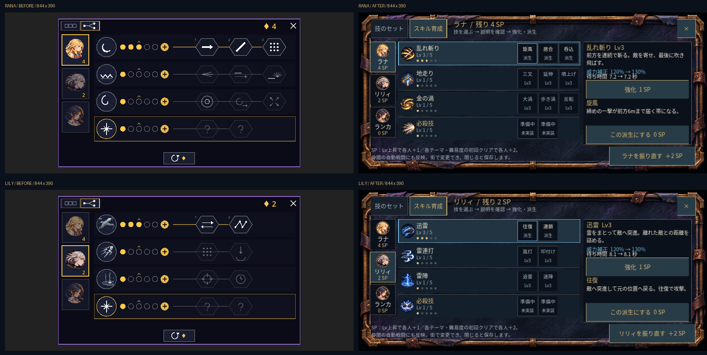

# スキル育成と技セットの改善（2026-11-15）

ソースは `codex/skill-tree-polish-20261115`。`codex/combat-hud-polish-20261115` の最新 `46d2741` から継続。完成済みの遠征盤と戦闘HUDは作り直していない。公開mainが14f7cf4へ進んでいたため、その公開物のソースc04e8b6を後から統合し、T3/T4・既存の戦闘修正を保持。main.gd／battle.gd／player.gd等は公開済みソースと同一で、今回独自の調整を加えていない。

## 使い方

1. 街の歯車から「スキル育成」を開く。左の顔でラナ／リリィ／ランカを切り替える。
2. 技の行を選ぶと、役割・技レベル・現在→次レベルの威力補正・待ち時間（必殺技はゲージ消費）が読める。
3. 「強化 1 SP」で確定。技や枝を押して説明を見ただけではSPを使わない。Lv2からの強化は派生開放も予告する。
4. 派生は技Lv3から。枝を選んで効果を確認し、「この派生にする 0 SP」で適用。同時に1つだけ。適用中の派生は「元の技に戻す」で外せる。
5. 「技のセット」では、下の技→上の枠の順に押す。同じ技が別の枠にあれば入れ替える。ラナの3枠という既存の範囲を維持。
6. 振り直しは選択中の1人だけ。戻るSPを表示し、3秒以内にもう一度押すと確定。閉じると保存され、戦闘用の技テーブルへ反映される。

SPはレベルアップで各人＋1、各テーマ×難易度の初回クリアで各人＋2。仲間の強化と派生は自動戦闘にも使われる。これらは既存ルールの説明で、今回の数値変更ではない。

## 見た目と実装

採用済み遠征盤の布・真鍮の背景、既存の肖像、戦闘HUDの12種類の技画像を再利用。生成・描き替え・画像ファイルの加工は行っていない。縦横比は既存の描画関数で維持。日本語は既存Noto Sans CJK JPサブセットの文字を保持して補充（既存 `tools/extend_ja_font.py` とSIL OFLライセンス）。戦闘／遠征盤は引き続き数字と絵のみ。

`skill_tree_presenter.gd` が説明と表示値、`skill_tree_art.gd` が描画とタッチ矩形、`dungeon_hud.gd` が既存progressへの操作を担当。現在の派生を含む `SkillTree.apply()` の結果から待ち時間を表示する。威力補正は技レベルの倍率で、敵への絶対ダメージや派生間の総ダメージ比較ではない。

比較および `evidence/rana_*`／`lily_*`／`ranka_*`／`ultimate_*`／`locked_*` は表示確認用fixture。SPや技Lvを設定しており、実プレイで獲得した状態とは区別する。`web_*` は実際の街から入ったWeb画面。

## 検証

Godot公式 `4.7.2.stable.official.ed1daf0bf`。

- PASS：候補選択ではSPが減らない、強化は1 SP、Lv2→3の派生解放、SP0／Lv5、派生の無料適用・解除、必殺派生は選択不可。
- PASS：キャラ切り替えで振り直し確認を解除、選択キャラだけの返却、2回確認、スロット交換、保存と読込、旧セーブのSP移行。
- PASS：844×390／1280×720、3人、全操作44px以上、タッチ領域の非重複、全技・派生説明の実測高さ。
- PASS：実際のmain.tscnでタッチ入力によるLv3強化、CD7.2への反映、保存、開閉時の3D／戦闘UI／入力の復元。
- PASS：既存combat_hud_model／binding／layout、dungeon_select_layout／state。戦闘・成長・派生patch・main.gdのパーティ処理は変更なし。
- 独立コードレビュー：Critical／Importantなし。Lv3予告とSP獲得条件の表記の指摘を反映。
- Web：同じ4.7.2の既存公式ランタイムを再利用し、公式4.7.2で本体・地区PCKを書き出す `WEB_PACK_ONLY=1` を使用。初回ローカルChromium844×390で街→歯車→育成→リリィ→技セット→閉じるを確認、pageerror／ScriptErrorなし。最終版の書き出し・公開確認は結果追記欄を参照。

再実行：`godot --headless --path sequel --script tests/skill_tree_ui_test.gd`（presenter／layout／liveも同様）。描画は `tests/skill_tree_render_test.gd`、Webは `node sequel/tools/check_skill_tree_web.cjs`（既定 `http://127.0.0.1:8765/`）。

## 未確認・既知の制約

iPhone実機の読みやすさ・入力遅延・速度、初見ユーザーの理解度は未確認。説明で理解しやすくなる点はデザイン上の仮説。実戦の全派生アニメーション・ダンジョン6周は今回再実行していない。過去のHUD検証は引き継ぎ資料の記録として扱う。

実シーンの強制終了では既存の控え仲間を含むObjectDB／RID解放警告を観測。テスト側で控えノードを片付ける前のheadlessは26件、ネイティブは24件。前回の「自動6周後2件」と条件が違うので同一件数とは扱わず、実装が原因とも断定しない。今回main.gdの解放処理は変更していない。

新しい技・必殺派生の中身・長押し・フリック・4枠目・成長の数値調整は追加していない。

## 最終書き出し・公開結果

検証後に追記する。
